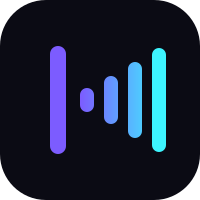
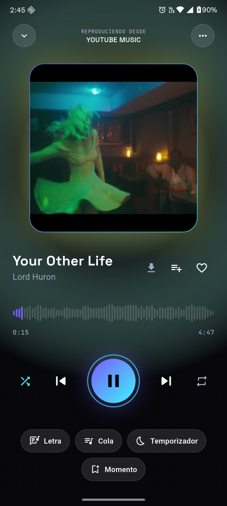
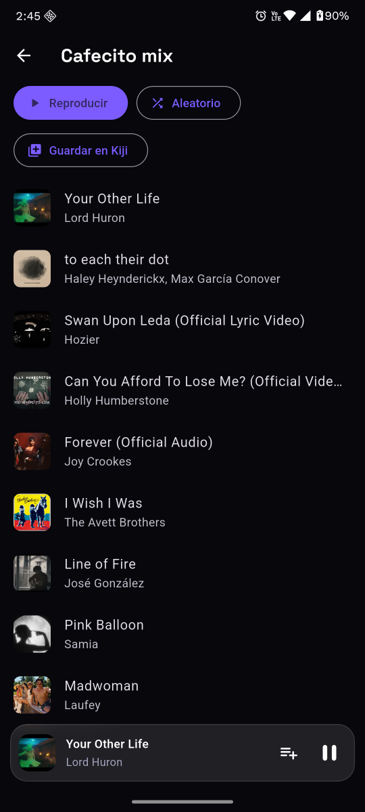
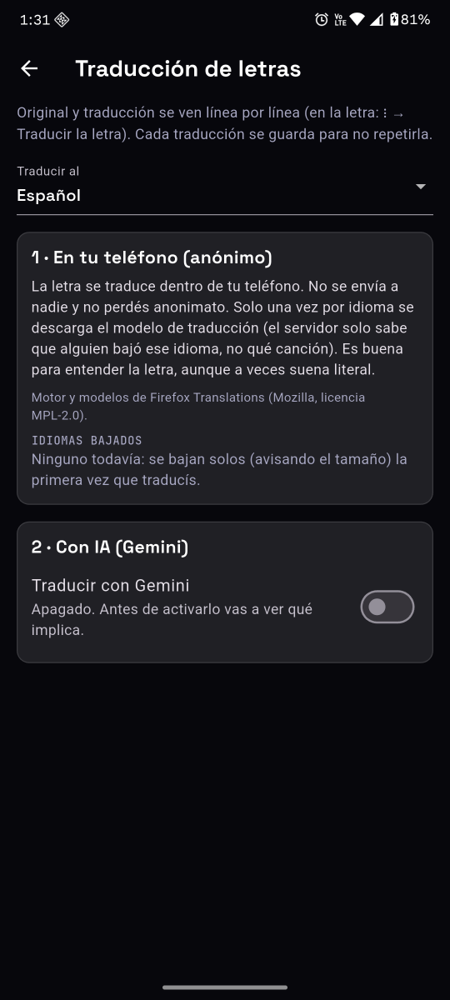

<p align="center">
  <a href="README.md">English</a> | <b>Español</b>
</p>

<p align="center">
  
</p>

<h1 align="center">Kiji Player</h1>

<p align="center">
  Un reproductor de música libre para Android y Windows.<br>
  Sin anuncios, sin pagos y sin rastreo.
</p>

---

Kiji reproduce tu música guardada y la de YouTube Music, de forma anónima. Todo lo tuyo (la cola,
las playlists, el historial y las descargas) se queda en tu dispositivo.

- Descargas para escuchar sin conexión, de una canción o de playlists enteras.
- Letras sincronizadas, con traducción en el propio teléfono.
- Inicio con recomendaciones calculadas en tu dispositivo.
- Temporizador para dormir, ecualizador, transición suave entre canciones y copia de seguridad.
- Importa playlists desde Echo Music, Metrolist, `.m3u` y otros formatos.
- En español e inglés.

## Capturas

<p align="center">
  
  
  
</p>

## Instalación

Las versiones se publican en [Releases](https://github.com/kijiplayer/kiji-player/releases). Kiji
funciona en Android 7 o más nuevo y en Windows 10/11.

Para compilarlo tú mismo necesitas [Flutter](https://flutter.dev) 3.47 o más nuevo:

```bash
flutter pub get
flutter build apk --flavor prod   # Android
flutter build windows             # Windows
```

## Licencia y créditos

Kiji es software libre bajo la licencia [GNU GPL-3.0](LICENSE).

Se basa en el trabajo de [Echo Music](https://github.com/EchoMusicApp/Echo-Music) y
[Metrolist](https://github.com/MetrolistGroup/Metrolist), dos reproductores libres para Android, y
de los proyectos de los que ellos descienden. La lista completa, con qué se tomó de cada uno, está
en [CREDITS.md](CREDITS.md).

Kiji se programa con ayuda de inteligencia artificial, y cada cambio lo revisa y aprueba una persona.

Kiji es un proyecto independiente, compatible con YouTube Music. No está afiliado ni respaldado por
Google ni YouTube.
