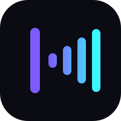
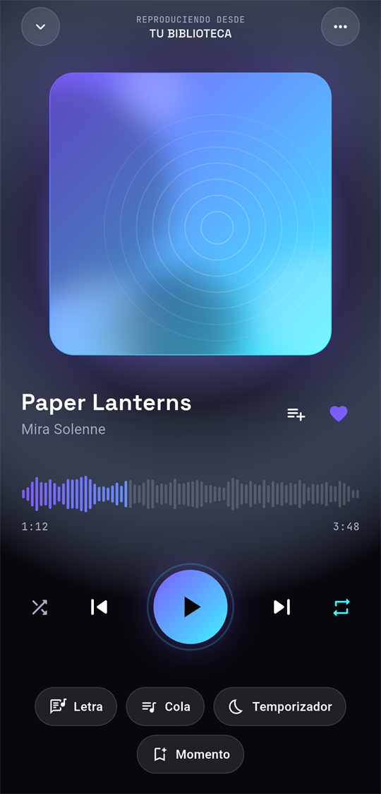
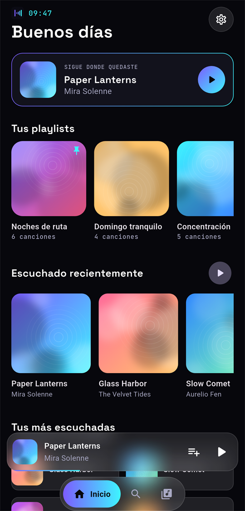
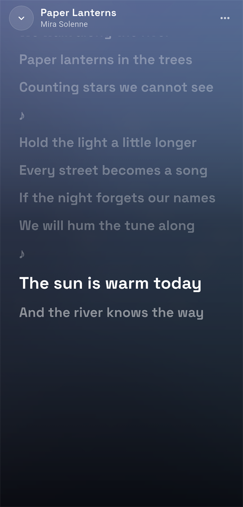
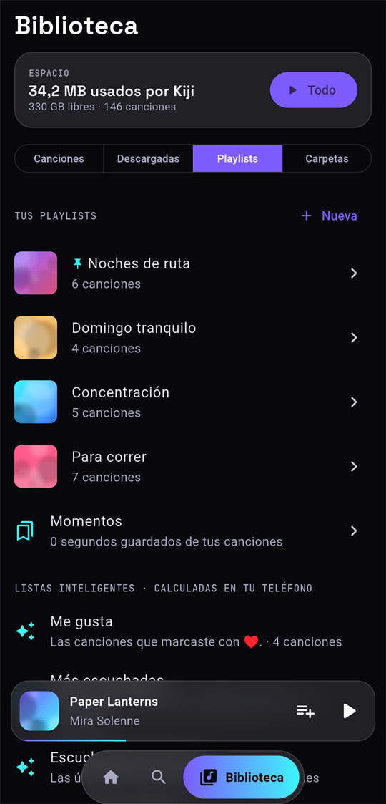
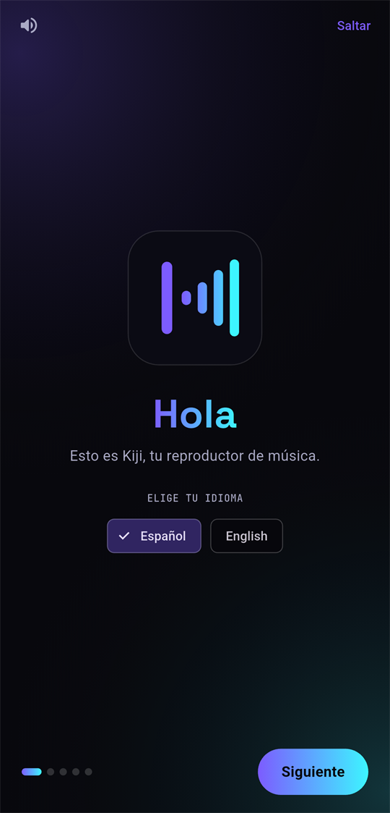
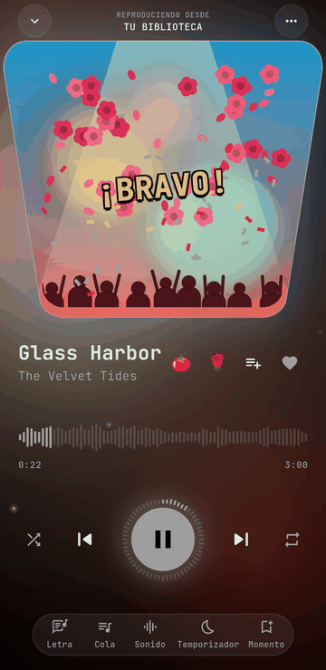
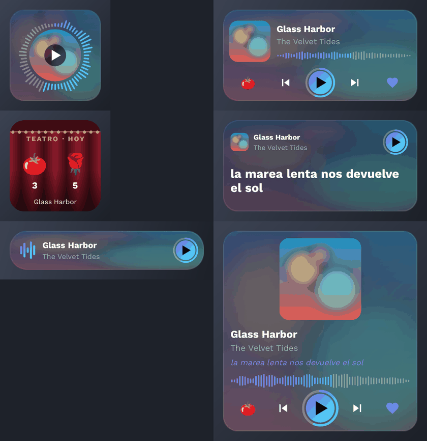

<p align="center">
  <a href="README.md">English</a> | <b>Español</b>
</p>

<p align="center">
  
</p>

<h1 align="center">Kiji Player</h1>

<p align="center">
  Un reproductor de música libre para Android y Windows.<br>
  Sin anuncios, sin pagos y sin rastreo.
</p>

---

Kiji reproduce tu música guardada y la de YouTube Music, de forma anónima. Todo lo tuyo (la cola,
las playlists, el historial y las descargas) se queda en tu dispositivo.

- Un reproductor a tu manera: tres estilos (Nocturne, Grafito y Papel), tu color, tu letra, un fondo
  propio (foto, GIF o video) y hasta un estilo para cada canción.
- Sonido: ecualizador con presets, bajos, velocidad, tono, efectos y mezcla entre canciones.
- Letras sincronizadas y karaoke palabra por palabra, guardadas con las descargas y con traducción
  en el propio teléfono.
- Biblioteca con artistas, álbumes y carpetas de tu música, y descargas para escuchar sin conexión.
- Importa playlists con un enlace (Spotify, Apple Music, SoundCloud o YouTube) o desde Echo Music,
  Metrolist y `.m3u`. Si quieres, conecta tu YouTube Music (opcional y solo lectura).
- Reacciones de teatro 🍅🌹: tomates hasta que cae el telón, rosas hasta la ovación, y «Tu Teatro».
- Widgets para la pantalla de inicio (en beta).
- Inicio con recomendaciones calculadas en tu dispositivo, temporizador y copia de seguridad completa.
- En español e inglés.

## Capturas

<p align="center">
  
  
  
</p>
<p align="center">
  
  
  
</p>
<p align="center">
  
</p>

<p align="center"><sub>Las canciones, artistas, portadas y letras de las capturas son inventadas.</sub></p>

## Instalación

Las versiones se publican en [Releases](https://github.com/kijiplayer/kiji-player/releases). Kiji
funciona en Android 7 o más nuevo y en Windows 10/11.

<p>
  <a href="https://apps.obtainium.imranr.dev/redirect?r=obtainium://add/https://github.com/kijiplayer/kiji-player"></a>
</p>

Con Obtainium, Kiji se actualiza en Android directamente desde esas versiones. Si pregunta qué APK usar, elige `Kiji-Player.apk` (sirve en cualquier celular) o el de tu arquitectura (`arm64-v8a` en la mayoría).

Para compilarlo tú mismo necesitas [Flutter](https://flutter.dev) 3.47 o más nuevo:

```bash
flutter pub get
flutter build apk --flavor prod   # Android
flutter build windows             # Windows
```

El APK de Android se puede volver a compilar y comparar con el publicado: ver
[docs/REPRODUCIBLE_BUILDS.md](docs/REPRODUCIBLE_BUILDS.md).

## Licencia y créditos

Kiji es software libre bajo la licencia [GNU GPL-3.0](LICENSE).

Se basa en el trabajo de [Echo Music](https://github.com/EchoMusicApp/Echo-Music) y
[Metrolist](https://github.com/MetrolistGroup/Metrolist), dos reproductores libres para Android, y
de los proyectos de los que ellos descienden. La lista completa, con qué se tomó de cada uno, está
en [CREDITS.md](CREDITS.md).

Kiji se programa con ayuda de inteligencia artificial, y cada cambio lo revisa y aprueba una persona.

Kiji es un proyecto independiente, compatible con YouTube Music. No está afiliado ni respaldado por
Google ni YouTube.
