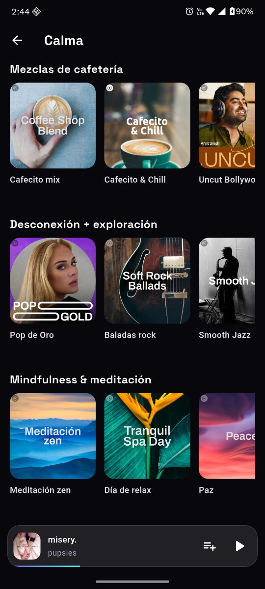
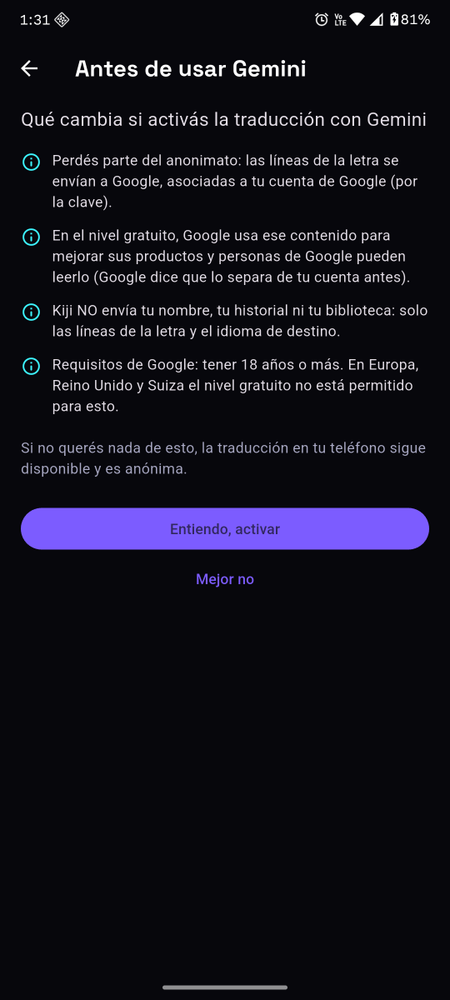

<p align="center">
  
</p>

<h1 align="center">Kiji Player</h1>

<p align="center">
  Reproductor de música libre para Android y Windows.<br>
  Sin cuentas obligatorias, sin anuncios y sin telemetría.
</p>

<p align="center">
  <a href="#english">English</a> · Licencia <a href="LICENSE">GPL-3.0</a> · <a href="CREDITS.md">Créditos</a>
</p>

---

## Manifiesto

- **Tu música es tuya.** La cola, las playlists, el historial, los "me gusta" y las descargas se
  guardan solo en tu dispositivo.
- **Sin cuentas.** Kiji funciona entero sin iniciar sesión en nada.
- **Sin anuncios ni telemetría.** Kiji no manda estadísticas a nadie.
- **Honesto.** Cada vez que algo sale a internet, Configuración → Privacidad explica qué se envía y a
  quién.
- **Libre.** El código es GPL-3.0 y se basa en otros proyectos libres, que se nombran en
  [CREDITS.md](CREDITS.md).

## Qué hace

- Reproduce tu **música local** y la de **YouTube Music** (anónimo, sin cuenta).
- Lleva un **Inicio** que se arma con tus gustos, calculados en el teléfono: "Porque escuchaste",
  "Mezcla para vos" y "Descubrí". Si recién empezás, propone géneros y estados de ánimo.
- Permite **descargar** canciones o playlists enteras para escuchar sin conexión. Avisa el tamaño,
  se puede pausar y respeta "solo con WiFi".
- Muestra **letras sincronizadas** de varias fuentes y las **traduce**:
  - En el teléfono, de forma anónima (motor de Firefox Translations).
  - Con Gemini, de forma opcional y con tu propia clave.
- Guarda **Momentos**: el segundo exacto de una canción, para volver a él o compartirlo.
- Trae temporizador para dormir (también "al terminar esta canción" o en un punto de la onda),
  ecualizador, transición suave y copia de seguridad diaria.
- Importa playlists desde Echo, Metrolist, InnerTune, OuterTune, `.m3u`, Exportify y Google Takeout.
- Avisa si hay una versión nueva (una consulta por día a GitHub, se puede apagar). Nunca se
  actualiza solo.

## Capturas

<p align="center">
  
  
  
</p>
<p align="center">
  
  
</p>

## Plataformas

| Plataforma | Estado |
|---|---|
| Android 7 o más nuevo | ✅ |
| Windows 10/11 | ✅ |
| Linux, macOS, iOS | Más adelante |

## Cómo instalar

Todavía no hay versiones publicadas. Cuando las haya, van a estar en la página
[Releases](https://github.com/kijiplayer/kiji-player/releases).

Para compilarlo vos hace falta [Flutter](https://flutter.dev) 3.47 o más nuevo:

```bash
git clone https://github.com/kijiplayer/kiji-player.git
cd kiji-player
flutter pub get
flutter run            # en un Android conectado o en Windows
flutter build apk      # APK para Android
flutter build windows  # app de Windows
```

## Aviso legal

Kiji Player es un proyecto independiente. **No está afiliado ni respaldado por Google, YouTube,
Mozilla ni ningún otro servicio que nombre.** Para escuchar contenido de YouTube Music, Kiji usa la
misma interfaz pública que usa la web; respetá los términos de cada servicio y los derechos de autor
de la música. Las descargas son para escuchar sin conexión dentro de Kiji.

---

<a id="english"></a>

## English (short version)

**Kiji Player** is a free (GPL-3.0) music player for Android and Windows. It needs no account and
has no ads and no telemetry: your queue, playlists, history and downloads stay on your device.

- It plays your local music and YouTube Music anonymously.
- Home is built from your taste, computed on the device.
- You can download songs and whole playlists for offline listening.
- It shows synced lyrics and translates them, either on the device or, optionally, with Gemini
  using your own key.
- "Moments" save an exact second of a song.
- It also has a sleep timer, an equalizer, daily backups, and imports from Echo, Metrolist, `.m3u`
  and more.

Build it with Flutter 3.47+: `flutter pub get`, then `flutter run`.

Kiji is not affiliated with or endorsed by Google, YouTube or Mozilla. See [CREDITS.md](CREDITS.md)
for the open-source projects and services it uses.
